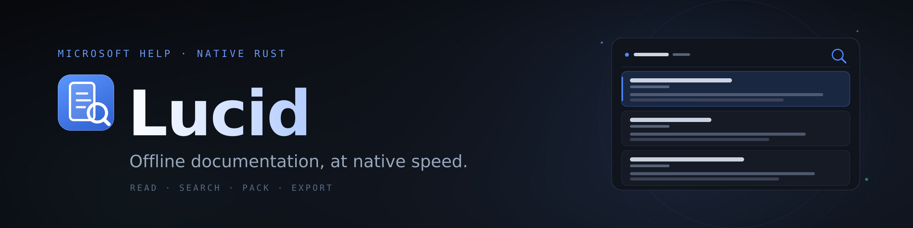
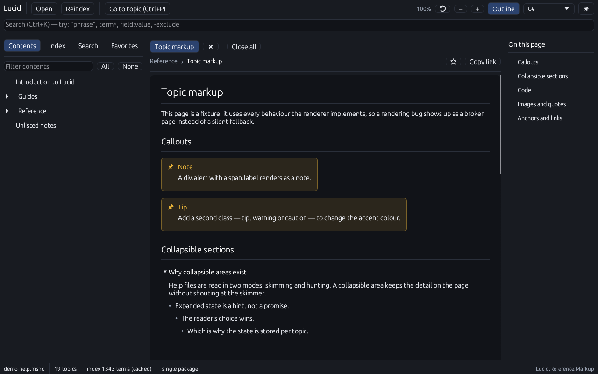
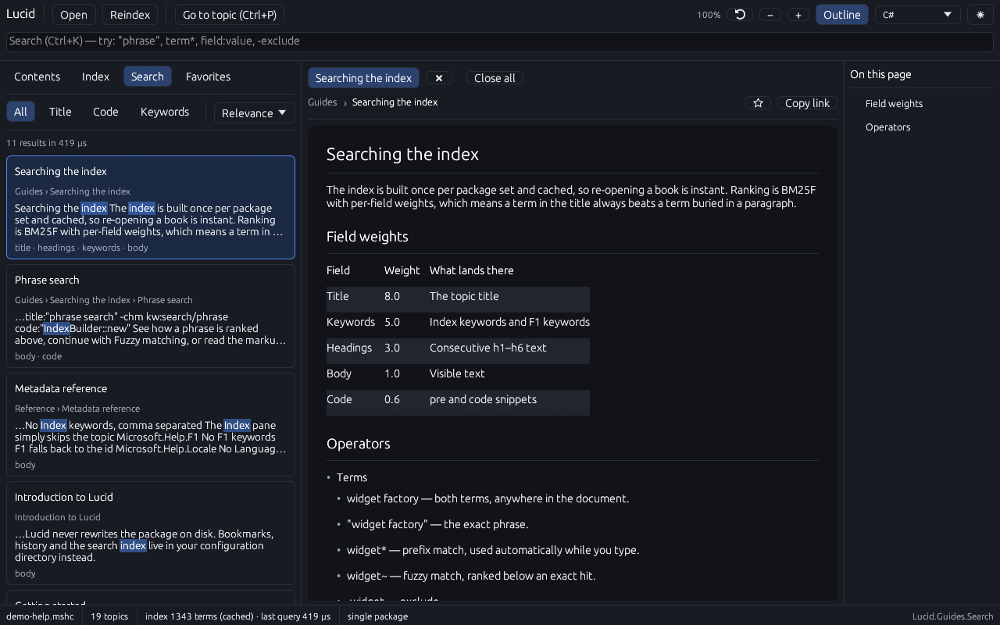
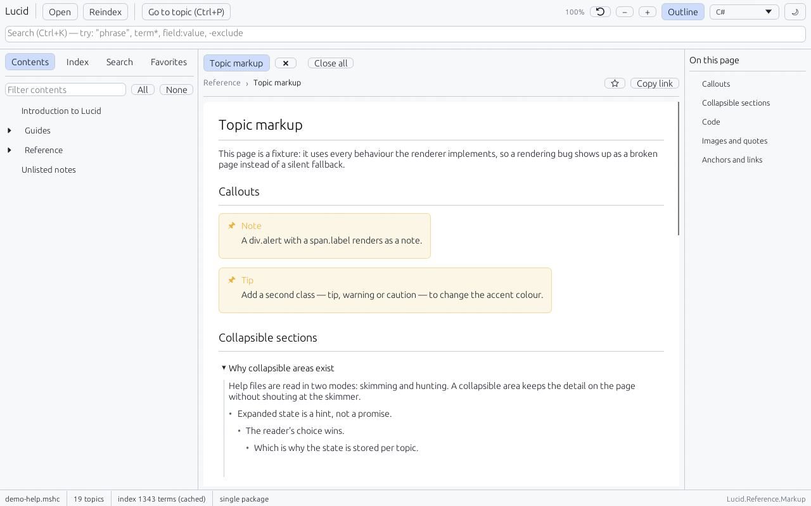

<p align="center">
  
</p>

<p align="center">
  <a href="https://ko-fi.com/gishi"></a>
  
  
  
</p>

<h3 align="center">Read, search and build Microsoft Help — without Visual Studio.</h3>

<p align="center">
  Lucid is a native <b>MSHC</b> and <b>CHM</b> reader, search engine and MSHC packer written in Rust.<br>
  One binary. No .NET runtime, no embedded browser, no index you have to wait for.
</p>

<p align="center">
  <sub><b>v1.1</b> — reading, search, export and packing all work, including CHM. Acceptance criteria live in
  <a href="SPEC.md">SPEC.md</a>.</sub>
</p>

<p align="center">
  <a href="#screenshots">Screenshots</a> ·
  <a href="#quick-start">Quick start</a> ·
  <a href="#what-it-does">Features</a> ·
  <a href="#search">Search</a> ·
  <a href="#command-line">Command line</a> ·
  <a href="#format-support">Format support</a> ·
  <a href="#architecture">Architecture</a> ·
  <a href="#support-lucid">Support ❤</a>
</p>

---

## Why Lucid?

Microsoft Help Container (`.mshc`, *MS Help 3*) is the offline documentation format that ships
with Visual Studio, Help Viewer and Sandcastle/SHFB. The official viewer is a .NET application
with an embedded browser and a flat keyword index. Lucid replaces it with a native window,
a ranked full-text engine and a packer, in a single Rust binary.

- **Opens what you have.** A single `.mshc`, a compiled HTML Help `.chm`, a whole Help
  Library `ContentStore/<LOCALE>` folder, or a `.msha` setup document — merged into one
  searchable library.
- **Renders what authors wrote.** SHFB and Sandcastle pages, collapsible areas, code snippets
  with language tabs, `languageSpecificText`, tables, callouts, images and cross-package links.
- **Searches like a modern editor.** BM25F ranking, phrases, prefixes, fuzzy fallback, field
  filters and highlighted snippets — backed by an index that persists between runs.
- **Packs it back.** `lucid-forge` builds valid, byte-for-byte reproducible `.mshc` packages
  from a folder of HTML.

## Screenshots

<p align="center">
  
</p>

<p align="center">
  <sub>The reader: contents, one topic and its outline — callouts, collapsible sections and code rendered natively.</sub>
</p>

| Search as you type | Light theme |
| :---: | :---: |
| [](assets/screenshots/search.png) | [](assets/screenshots/reading-light.png) |
| Ranked hits, filter chips and exact snippet highlights | The same documentation in the light palette |

<sub>All screenshots use the self-authored demo package written by `lucid demo testdata/demo-help.mshc`. No third-party documentation is bundled with Lucid.</sub>

## Quick start

Rust 1.86 or newer is required. On Linux, install the usual X11/Wayland/OpenGL development
headers — Lucid needs no GTK, no WebKit and no .NET:

```bash
# Debian / Ubuntu
sudo apt-get install -y pkg-config libxkbcommon-dev libwayland-dev libx11-dev libxi-dev \
    libgl1-mesa-dev libxcursor-dev libxrandr-dev libxinerama-dev
```

```bash
git clone https://github.com/gishi/lucid.git
cd lucid
cargo run --release -- testdata/demo-help.mshc
```

Or build once and run the binary directly:

```bash
cargo build --release
./target/release/lucid --help
```

Open your own documentation the same way:

```bash
lucid help.mshc                                  # one package
lucid legacy.chm                                 # a compiled HTML Help archive
lucid path/to/HelpLibrary/ContentStore/en-US     # a whole content store
lucid setup.msha                                 # a setup document
lucid help.mshc --f1 System.String               # resolve an F1 keyword
```

The window opens maximized. `--size 1280x800` pins an exact size, `--theme light|dark`
overrides the palette, and `--screenshot out.png` renders once and exits (used for the images
above and for layout checks during development).

## What it does

### Read

- Tabs, history and bookmarks; `Alt+←` / `Alt+→` walk the reading history.
- A per-topic **On this page** outline, in-topic find with highlighting, and zoom.
- Dark and light palettes with a document surface tuned separately from the chrome.
- A filterable contents tree, an index pane with multi-select keywords, and `F1` keywords
  highlighted in green for context-sensitive help.
- Drag and drop a package, `.chm`, folder or `.msha` anywhere in the window.
- `ms-xhelp:///?Id=…`, `ms-its:` / `mk:@MSITStore:` links, relative links, `#anchors` and
  cross-package links resolve inside the viewer; external URLs open in your browser.

### Search

Search-as-you-type over the whole content set, with results grouped by package and a
**persisted index** in `$XDG_CACHE_HOME/lucid/index/<fingerprint>.idx`. Reopening a book is
instant; `F5` rebuilds the index when you change the source.

| Query | Meaning |
| --- | --- |
| `install` | ranked hits, title ≫ keywords > headings > body > code |
| `phrase search` | both terms required |
| `"phrase search"` | exact adjacency, in the same field |
| `sear*` | prefix match (the last word is also a prefix automatically) |
| `serach~` | fuzzy match, ranked below exact hits |
| `-legacy` | exclusion |
| `search OR index` | union |
| `title:install` · `body:"getting started"` | field filters |
| `code:DocSet` · `kw:setup` · `id:…` · `path:…` | field filters |

Ranking is BM25F with per-field weights; results carry exact highlight ranges, filter chips,
per-package scope, sorting by relevance/title/path, and "did you mean" suggestions when nothing
matches.

### Pack

`lucid-forge` reads a folder of topic HTML, collects the `Microsoft.Help.*` meta tags,
synthesizes the `HelpContentSet` manifest and writes the OPC parts:

```bash
lucid-forge build ./docs -o Product.mshc --title "Product docs" --locale en-us
lucid-forge validate Product.mshc
lucid-forge outline Product.mshc
```

The same input produces the same bytes: packages are deterministic, so they can be committed,
diffed and reproduced.

## Command line

```text
lucid [<path>] [--topic <id>] [--search <term>] [--f1 <keyword>] [--no-index]
      [--pane contents|index|search|favorites] [--theme dark|light]
      [--size WxH] [--no-maximize] [--screenshot out.png] [--frames N]
lucid info <path> [--json]
lucid toc <path> [--depth N]
lucid search <path> <query> [--limit N] [--json]
lucid extract <path> -o <dir> [--force]
lucid demo <out.mshc> [--force]
lucid --version | --help
```

| Command | Purpose |
| --- | --- |
| `lucid info` | packages, topics, TOC and index statistics |
| `lucid toc` | ASCII table of contents |
| `lucid search` | ranked results with snippets (`--json` for tooling) |
| `lucid extract` | unpack topics and assets |
| `lucid demo` | write the self-authored demo package |
| `lucid --f1 <keyword>` | resolve an F1 keyword and open that topic |

Exit codes: `0` success · `1` I/O or format error · `2` usage error · `3` topic or keyword not
found. `--topic <id>` and `--f1 <keyword>` are the hooks for context-sensitive help from your
own application.

## Format support

| Input | Status |
| --- | --- |
| `.mshc` (DocMounter, Help Viewer 1.x/2.x, SHFB/Sandcastle output) | full support |
| `.chm` (Compiled HTML Help, Help 1.x) | read-only: topics, TOC, index, search, assets, links |
| Content-store folder (`ContentStore/<LOCALE>`) | full support, merged into one library |
| `.msha` setup document | package discovery |
| `.mshi` / `.metadata` sidecars | best effort |
| `.cab` content packages | detected with an actionable error (extract first) |
| HxS (`*.hxs`) | roadmap |

The renderer understands the legacy markup that real packages contain: `div.pageHeader` /
`pageFooter`, `table.titleTable`, `div.codeSnippetContainer` with `ChangeTab`, Sandcastle
`div.code` blocks, `collapsibleAreaRegion` / `collapsibleSection`, `languageSpecificText`
(`cs=.|vb=.|cpp=::|nu=.`), and block-level `<br>`. Details and the compatibility rationale are
in [`docs/DESIGN.md`](docs/DESIGN.md) §2.3.

## Architecture

```text
crates/lucid-mshc    format core: zip/OPC and CHM → packages → topics, TOC, keywords, assets
crates/lucid-search  inverted index + BM25F, query language, snippets, suggestions, persistence
crates/lucid-forge   the packer (library + CLI) and the demo-package generator
crates/lucid         the application: egui GUI + headless CLI
docs/DESIGN.md       format algorithm, frozen APIs, UX specification
SPEC.md              requirements and v1.1 acceptance criteria
testdata/            demo-help.mshc / demo-help.chm — committed, self-authored samples
```

| Crate | Role |
| --- | --- |
| `lucid-mshc` | MSHC/CHM parsing: packages, content sets, TOC/index reconstruction, assets |
| `lucid-search` | ranked, instant full-text search: BM25F, phrases, prefixes, fuzzy, snippets |
| `lucid-forge` | MSHC packer and validator; builds valid OPC + `HelpContentSet` packages |
| `lucid` | native egui application, reader, panes and the headless command line |

CHM decoding uses a vendored copy of [`libchm`](https://crates.io/crates/libchm) 0.3.0 (MIT);
the vendored reader lives in `crates/lucid-mshc/src/chm/vendor/` and its license is kept
alongside the code. Only MSRV substitutions were applied, so the crate stays compatible with
Rust 1.86.

## Development

```bash
cargo check --workspace --all-targets     # warning-free gate
cargo test --workspace                    # parser, TOC, index, ranking, packer round-trips
cargo run -p lucid-forge -- demo testdata/demo-help.mshc --force   # regenerate the sample
```

Notes for contributors:

- **MSRV is 1.86.** `image`, `zip` and the `icu_*` chain are pinned for it; newer releases
  require rustc 1.88+. If you bump one, run `cargo tree -i <crate>` first and keep
  `Cargo.lock` in the commit.
- **No `unsafe`.** Every crate starts with `#![forbid(unsafe_code)]`.
- **CI gate.** GitHub Actions and GitLab CI both run
  `cargo check --workspace --all-targets` and `cargo test --workspace` on Linux. See
  [`.github/workflows/ci.yml`](.github/workflows/ci.yml) and
  [`.gitlab-ci.yml`](.gitlab-ci.yml). `clippy` and `rustfmt` are expected locally when
  available.
- **Demo content is generated**, not vendored: Lucid redistributes no third-party
  documentation.
- **Pull requests are welcome.** Keep the frozen APIs in `docs/DESIGN.md` in sync and add a
  test for every parser or ranking change.

The banner, app icon and screenshots are described in [`assets/README.md`](assets/README.md).

## Releases

Release archives are built from tags:

```bash
git tag v1.1.0
git push origin v1.1.0
```

GitHub Actions publishes Linux x86_64, macOS x86_64/arm64 and Windows x86_64 archives
(each containing `lucid`, `lucid-forge`, `README.md`, `LICENSE` and `CHANGELOG.md`) plus
`SHA256SUMS.txt`.
GitLab CI builds Linux natively and mirrors the macOS/Windows archives from the GitHub
release into the GitLab Generic Package Registry, so the GitLab release also links all four
archives plus checksums. Both workflows refuse a tag whose version differs from
`Cargo.toml`.

## Roadmap

In-process `.cab` support, syntax highlighting for code snippets, a CSS subset, PDF/EPUB
export, optional semantic search, CHS/HxS (`.hxs`) import and a GUI authoring mode. The order
and the reasoning live in [`docs/DESIGN.md`](docs/DESIGN.md) §7; the acceptance criteria are
in [`SPEC.md`](SPEC.md).

## Support Lucid

Lucid is independent, MIT-licensed and developed in the open. If it saves you time, you can
support its development on Ko-fi:

<p align="center">
  <a href="https://ko-fi.com/gishi"></a>
</p>

<p align="center"><b><a href="https://ko-fi.com/gishi">ko-fi.com/gishi</a></b></p>

Every contribution pays for the time that goes into the next release. If you cannot donate,
a star, a bug report or a package that fails to open is just as useful.

## License

MIT — see [`LICENSE`](LICENSE). Microsoft, Visual Studio, Windows and Help Viewer are
trademarks of Microsoft Corporation. Lucid is not affiliated with Microsoft; the `.mshc` format
is Microsoft's, while the Lucid code, name and demo content are original.
